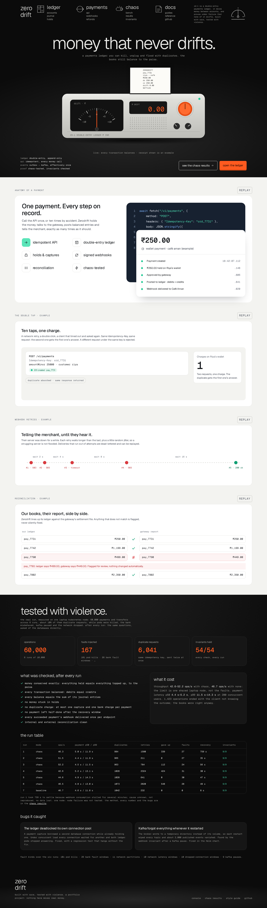
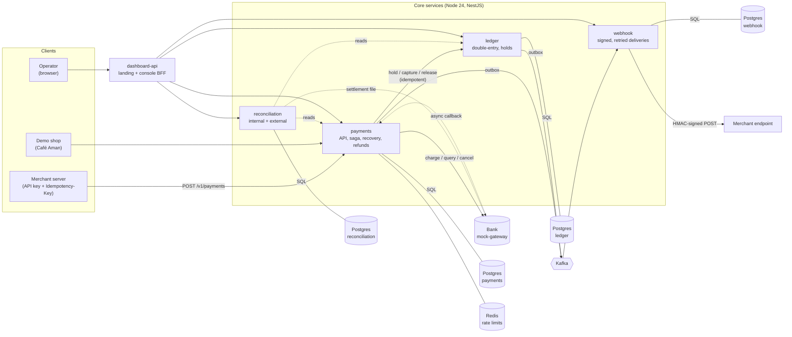
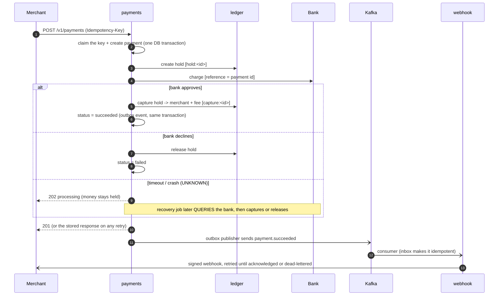
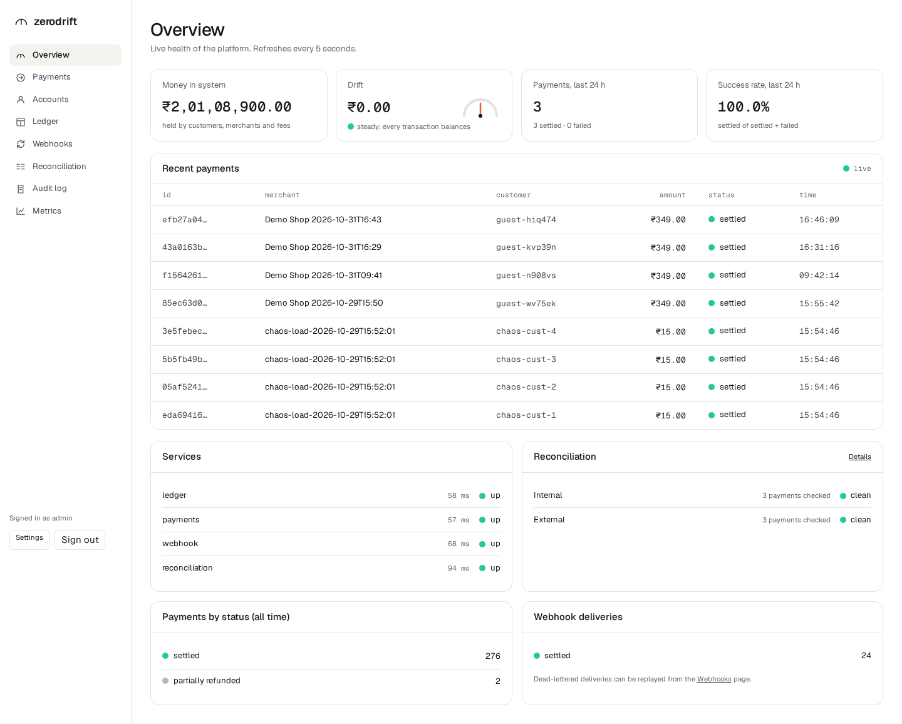
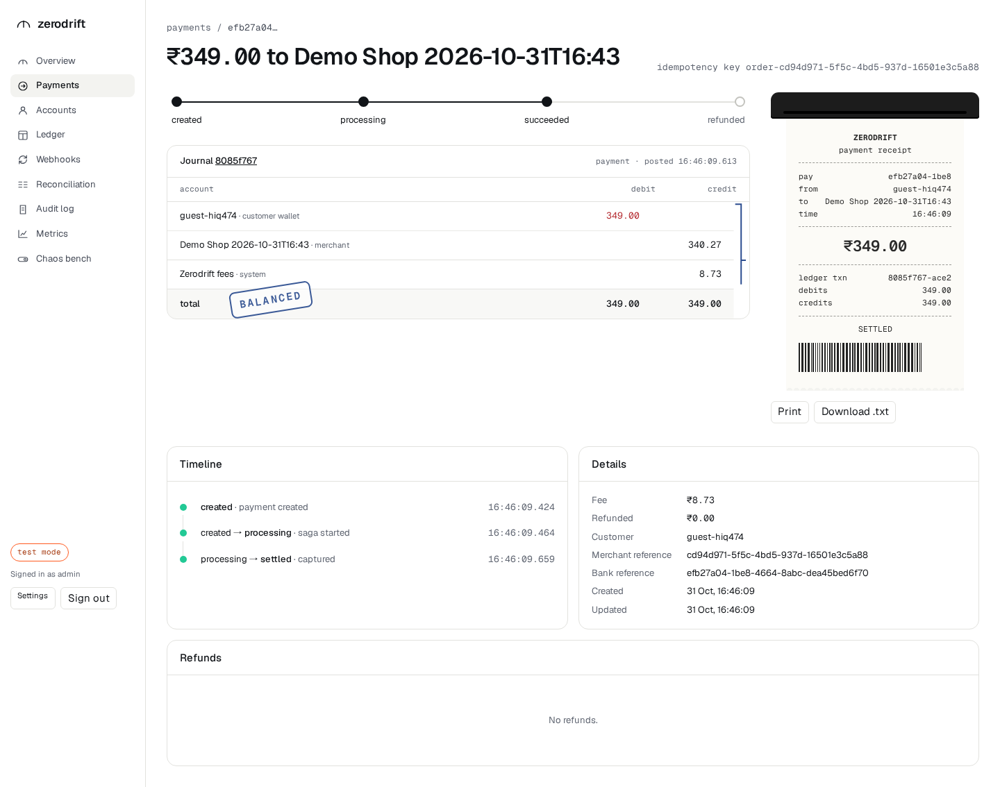
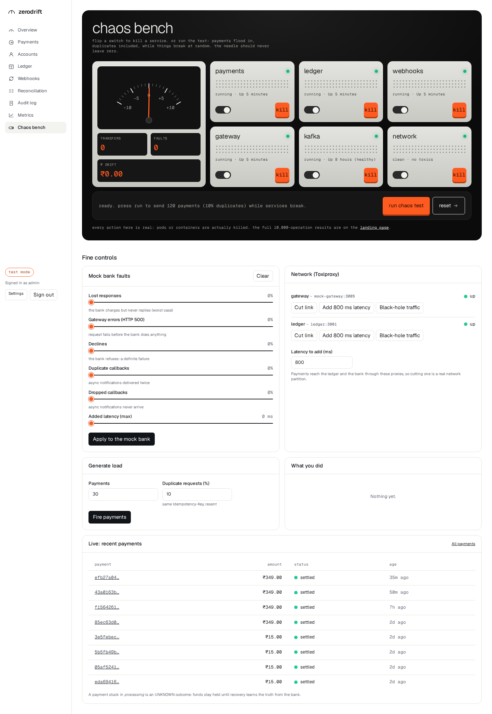
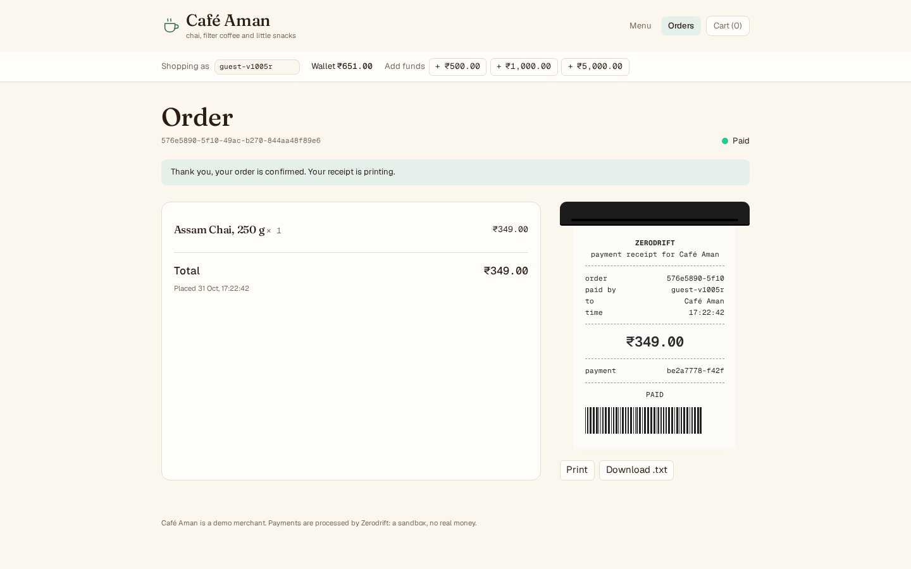

# Zerodrift

**A payments and wallet backend, a mini Razorpay, that moves money correctly even when services crash, networks fail and requests repeat.**

Zerodrift is a double-entry ledger, an idempotent payments API, a Kafka-based event pipeline with signed webhooks, and a reconciliation engine, plus the thing that proves it works: a chaos harness that kills pods, pauses Kafka, makes the bank lie, floods the API with duplicate requests, and then asks the databases whether a single paisa went missing.

It is a portfolio project: nothing here moves real money. The bank is a mock. Everything else is built the way a real payments platform has to be.



> **The result, measured:** 6 chaos runs of 10,000 payments and transfers each, 167 injected faults (101 pod kills, Kafka pauses, bank faults, network partitions), about 6,000 duplicate requests, on one laptop Kubernetes node. All 9 invariants held in every run: money conserved to the paisa, no duplicate charge, nothing stuck, every webhook delivered once. The chaos test also found **two real bugs**, both fixed and documented. Details and the raw table: [`docs/CHAOS_RESULTS.md`](docs/CHAOS_RESULTS.md).

## Contents

- [What it does](#what-it-does) · [Architecture](#architecture) · [The money rules](#the-money-rules) · [What it guarantees (and what it cannot)](#what-it-guarantees-and-what-it-cannot)
- [Run it](#run-it) · [Prove it](#prove-it-the-chaos-test) · [Screenshots](#screenshots) · [Limitations](#limitations)
- [Repository map](#repository-map) · [Learn from it](#learn-from-it) · [Deploying](#deploying)

## What it does

| Capability | How |
|---|---|
| **Double-entry ledger** | Every movement of money is a balanced set of journal entries (debits equal credits), written once and never edited or deleted. Balances are credits minus debits, and the sum of all balances is always zero. |
| **Holds and captures** | A payment first *holds* the customer's money (still theirs, not spendable), then *captures* it to the merchant and the platform fee in one atomic ledger transaction, or releases it. |
| **Idempotent API** | Every money-moving call takes an `Idempotency-Key`. Same key and same request: the stored response comes back. Same key, different request: HTTP 422. Concurrent duplicates never both execute. |
| **Payment saga with recovery** | `hold -> ask the bank -> capture`, with deterministic keys at every step and a recovery job that finishes anything a crash or a timeout left half-done. A timeout is an *unknown* outcome, never a failure. |
| **Events through Kafka** | A transactional outbox (an event is written in the same database transaction as the change), a publisher, and idempotent consumers with an inbox table, retries and dead-letter topics. |
| **Signed webhooks** | HMAC-signed, retried with exponential backoff and jitter, dead-lettered after the limit, replayable, with a delivery log and an SSRF guard. |
| **Refunds** | Partial and full, with the platform fee returned proportionally; refunds are ledger reversals, never edits. |
| **Reconciliation** | Internal (the books balance and match the payments) and external (payments match the bank's settlement file). Mismatches are flagged, never silently fixed. |
| **Operator console + landing page** | A React app: live overview, payment detail with its journal and receipt, ledger, webhook delivery tracks, reconciliation, audit log, metrics, and a chaos bench wired to the real fault injector. |
| **Operations** | Rate limiting per merchant (Redis), append-only audit log, correlation ids, structured logs, Prometheus metrics, OpenTelemetry traces, health and readiness probes, graceful shutdown. |

## Architecture



Each service owns its own database; no service reads another's tables. They talk over HTTP (synchronous commands) and Kafka (asynchronous facts).

**One payment, step by step** (every arrow is safe to repeat; the key in brackets makes it so):



## The money rules

These are enforced in code **and** by the database, and the test suites attack each one:

1. **Money is an integer of minor units** (paise), `bigint` in code and `BIGINT` in Postgres. No floats anywhere; amounts travel as strings and stay exact beyond 2^53.
2. **Journal entries are immutable.** To undo something you post a reversal. A trigger rejects `UPDATE`, `DELETE` and `TRUNCATE` on the journal.
3. **Every transaction balances.** Checked in code (a clear error) and by a deferred constraint trigger at `COMMIT` (the last line of defence).
4. **No negative balance** unless the account is flagged to allow it (only system accounts like the bank clearing account). A trigger rejects it even if application code is wrong.
5. **Accounts are locked in id order** inside a transaction, so two transfers in opposite directions cannot deadlock.
6. **Idempotency:** same key and request returns the stored response; a different request under the same key is rejected (422); concurrent duplicates block on the key and never both execute.
7. **A timeout is an unknown outcome, not a failure.** The payment stays `processing`, the money stays held, and recovery asks the bank before deciding.

## What it guarantees (and what it cannot)

- **Guaranteed:** money is conserved to the paisa; every transaction balances; a customer is charged at most once per idempotency key; a payment never ends up half-done after the recovery window; every succeeded payment's webhook is delivered or dead-lettered exactly once per endpoint.
- **Not guaranteed, by physics:** *exactly-once delivery* does not exist over a network. Zerodrift gives **at-least-once delivery with idempotent handling**, which has the *effect* of exactly-once. A webhook can reach a merchant's server more than once (they must deduplicate on the event id, which every webhook carries); a client can get a timeout for something that did happen (so it must retry with the same key). [`docs/LEARN.md`](docs/LEARN.md) explains why in the "exactly-once" section.

## Run it

You need Docker, Node 24 and pnpm 12 (`corepack enable` is enough).

```bash
pnpm install
pnpm start:local      # one command: builds, starts everything, waits until it is really ready, seeds demo data once, prints the URLs and logins
pnpm verify:features  # 46 live checks of every feature through the real APIs (payments, idempotency, refunds, webhooks, recovery, ...)
```

(`pnpm start:local` is `docker compose up -d --build` plus the waiting and the seeding. `pnpm stop:local` stops it and keeps your data.) A click-by-click checklist for testing everything by hand is in [`docs/MANUAL_TEST.md`](docs/MANUAL_TEST.md).

Then:

| What | Where | Login |
|---|---|---|
| Landing page and operator console | http://localhost:3008 (console at `/app`) | `admin` / `zerodrift` (development defaults) |
| Demo shop (Café Aman) | http://localhost:3009 | none; add funds, then pay from the wallet |
| Merchant API | http://localhost:3002 | API key from `POST /admin/merchants` |
| Grafana, Jaeger, Kafka UI | :3000, :16686, :8080 | |

### Login credentials (local development stack)

These are **development defaults**, safe only because the stack is on your own machine. The services refuse them when `NODE_ENV=production`.

| Where | Username | Password / token |
|---|---|---|
| **Operator console** (http://localhost:3008/app, or the login page at `/login`) | `admin` | `zerodrift` |
| **Demo shop** (http://localhost:3009) | none | none: you shop as an auto-created guest (`guest-xxxxxx`); click **+₹1,000.00** to add wallet funds |
| **Admin API token** (header `x-admin-token`, used by scripts and the seed) | | `dev-admin-token` |
| **Merchant API** (header `Authorization: Bearer <key>`) | | a key is created and shown **once** by `POST /admin/merchants` (the seed script prints two). Create your own: `curl -X POST localhost:3002/admin/merchants -H 'x-admin-token: dev-admin-token' -H 'content-type: application/json' -d '{"name":"My shop"}'` |
| **Postgres** (localhost:55432) | `zerodrift` | `zerodrift` (databases `ledger`, `payments`, `webhook`, `reconciliation`, `gateway`) |
| **Grafana** (:3000) | none | anonymous admin in the development stack |
| Redis (:56379), Kafka (:9094), Kafka UI (:8080), Jaeger (:16686) | none | no authentication locally |

To change the console login locally, start the stack with your own values: `DASHBOARD_PASSWORD='something-long' ADMIN_TOKEN='your-token' docker compose up -d`.
In production none of these defaults work: you set every secret in `.env` (see [`.env.example`](.env.example) and [`docs/DEPLOYMENT.md`](docs/DEPLOYMENT.md)).

Fill it with demo data (merchants, customers, 80 payments, duplicates, refunds, one payment whose bank answer is lost and then recovered):

```bash
ADMIN_TOKEN=dev-admin-token LEDGER_URL=http://localhost:3001 RECON_URL=http://localhost:3004 \
  GATEWAY_URL=http://localhost:3005 node scripts/seed-demo.mjs
```

Develop and test:

```bash
pnpm install
pnpm test        # 361 tests; they start real Postgres, Kafka and Redis with Testcontainers (Docker required)
pnpm lint && pnpm typecheck && pnpm build
pnpm e2e:smoke   # a real browser (in a container) walks every page and completes a checkout
```

## Prove it: the chaos test

```bash
pnpm chaos       # creates a local Kubernetes cluster (kind) if needed, runs 10,000 operations with faults, prints the invariant report
NO_CHAOS=1 pnpm chaos   # the same load without faults, for comparison
```

It seeds merchants and funded customers through the public API, runs k6 (75% payments, 25% transfers, about 10% duplicate requests sent twice at the same moment, clients retrying with the same key) while an injector kills payments, ledger and webhook pods, pauses Kafka, makes the bank slow, erroring and lossy, and cuts and delays the network. Then it removes every fault, waits for recovery, runs both reconciliations and an **independent SQL checker** (no service code) over all four databases. The checker has its own tests that corrupt a real database in a dozen ways and prove each corruption is detected.

| Run | Operations | Faults | Duplicate pairs | Invariants held |
|---|---|---|---|---|
| 1 to 6 (chaos) | 10,000 each (60,000) | 24 to 31 each (167) | 6,041 | **9/9 in every run** (54/54) |
| baseline (no faults) | 10,000 | 0 | 1,042 | 9/9 |

Throughput on one shared laptop node: 42.6 to 52.2 operations/s with chaos, 46.7 without: the limit is the machine, not the faults. Full tables, method, and the two bugs it caught (a connection-pool deadlock in the ledger, and Kafka losing its data on restart) are in [`docs/CHAOS_RESULTS.md`](docs/CHAOS_RESULTS.md).

## Screenshots

| | |
|---|---|
|  |  |
| Overview: real KPIs, live payments table | A payment: state line, journal, receipt |
|  |  |
| The chaos bench, wired to the real fault injector | The demo shop: checkout hands off to Zerodrift |

## Limitations

Honest list; none of it is hidden in the code:

- **The bank is a mock.** A real gateway needs an adapter, PCI scope analysis, KYC/AML; none of that is here.
- **INR only**, one currency per transaction; currency is still a column everywhere.
- **One Kubernetes node** in the chaos test: pod, process, network and dependency failures are covered; **node failure is not**. Postgres is a single instance (no failover), Kafka a single broker (replication factor 1).
- **Throughput numbers are laptop numbers** (about 46 operations/s at 200 concurrent users on a shared 8-CPU, 8 GB machine). They say nothing about how the design scales; the p99 latency was 11 to 14 s under that saturation.
- One chaos run took 759 s to settle because webhook consumption stalled for several minutes; the cause is still unknown and it did not recur in five later runs. What was ruled out by measurement: a crashed consumer's work moves to a survivor in about 30 s (now 10 to 13 s after a tuned session timeout), with nothing lost or handled twice (`packages/kafka/test/failover.test.ts`).
- Kafka clients speak plain brokers only (no SASL/TLS yet), so managed Kafka services are not supported as-is.
- The operator console has one account. It is for operating the demo, not a multi-tenant merchant dashboard.

## Repository map

```
services/
  ledger/            double-entry posting, holds, reversals, invariants          (3001)
  payments/          merchant API, saga, recovery, refunds, rate limiting         (3002)
  webhook/           signed deliveries, retries, dead letters, replay             (3003)
  reconciliation/    internal + external reconciliation                           (3004)
  mock-gateway/      the demo bank: idempotent charges, fault knobs, settlement   (3005)
  chaos-controller/  fault injection API (Docker or Kubernetes). TEST ONLY        (3006)
  dashboard-api/     console backend (JWT), landing data, metrics proxy           (3008)
  demo-shop/         the merchant's storefront backend                            (3009)
  demo-receiver/     webhook receiver used in tests
packages/            money, config, db, events, kafka (outbox, inbox), common, telemetry, webhooks, ui, brand, testing
apps/dashboard/      landing page + operator console (React)      apps/shop/   Café Aman storefront (React)
chaos/               the harness: seed, k6 load, fault injector, independent invariant checker
deploy/              Helm charts (kind + production values), production Compose + Caddy, image build
docs/                CHAOS_RESULTS, LEARN, FAILURES, INTERVIEW, DEPLOYMENT, ENVIRONMENT, DEMO_VIDEO, SECURITY
design/              the approved design reference and its screenshots
```

About 14,500 lines of source and 5,800 lines of tests, TypeScript throughout.

## Learn from it

This repository was written to be studied.

1. [`docs/LEARN.md`](docs/LEARN.md): a guided tour in reading order; every core concept with the exact file and function where it lives.
2. [`docs/FAILURES.md`](docs/FAILURES.md): what happens when each component fails or is slow, and how the system recovers (and what it does not promise).
3. [`docs/MANUAL_TEST.md`](docs/MANUAL_TEST.md): test every feature by hand, with what you should see.
4. [`docs/INTERVIEW.md`](docs/INTERVIEW.md): 50 interview questions with answers based on how *this* code works, a 2-minute pitch and a 10-minute deep-dive outline.
4. [`NOTES.md`](NOTES.md): the decisions and trade-offs, phase by phase, including every bug found and how.
5. [`docs/SECURITY.md`](docs/SECURITY.md): the threat model and what each control does.

## Deploying

Prepared and verified locally, **not deployed**: [`docs/DEPLOYMENT.md`](docs/DEPLOYMENT.md) (free-tier options with verified limits, what runs live vs demo-only, runbook), [`docs/ENVIRONMENT.md`](docs/ENVIRONMENT.md) (every variable), [`.env.example`](.env.example), production Compose with automatic HTTPS in [`deploy/compose/`](deploy/compose/), production Helm values in [`deploy/helm/zerodrift/values-prod.yaml`](deploy/helm/zerodrift/values-prod.yaml), and a 90-second [demo video script](docs/DEMO_VIDEO.md).

The product name lives in one backend constant (`PRODUCT_NAME` in `@zerodrift/config`) and one frontend place (`@zerodrift/brand`).
